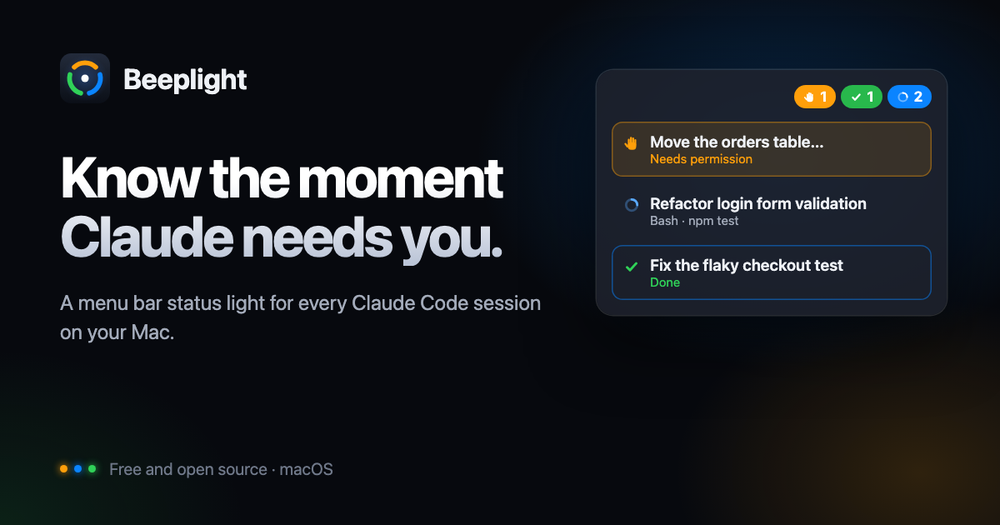

<p align="center">
  <a href="https://beeplight.dev"></a>
</p>

# Beeplight — for Claude Code

**Know the moment Claude needs you.** Beeplight is a free, open-source status light for every Claude Code session and agent on your Mac.

[beeplight.dev](https://beeplight.dev) · **English** · [简体中文](README.zh-CN.md)

Beeplight checks every session three times a second, sorts them into **Doing**, **Waiting** and **Done**, and takes you straight to the right window when you click one. Start a task, go do something else, and the menu bar tells you when Claude needs you or has finished.

It has a SwiftUI menu bar app and a web board. Both show the same live data, in English or Simplified Chinese depending on your system language; task titles follow the Mac's language too. To pick a language for Beeplight alone, choose it in the app's Settings → General (the same choice as System Settings → General → Language & Region → Applications).

> [!NOTE]
> **Early preview.** There are no signed builds or Homebrew cask yet, so for now you build the app from source; it takes about a minute. Signed, notarized builds will be on [beeplight.dev](https://beeplight.dev) and [Releases](https://github.com/derek920/beeplight/releases) with the first release.
>
> Beeplight is an independent project. It is not affiliated with or endorsed by Anthropic. Claude and Claude Code are trademarks of Anthropic.

## Features

- **Menu bar status**: a blue spinner and count while Claude is working, an orange raised hand and count when a task is waiting for you (it turns red if it waits too long), and an empty check mark when everything is handled.
- **Click to jump**: opens the exact iTerm2 or Terminal tab, the Claude desktop session, or the project window in VS Code, Cursor or Trae. Background (`claude --bg`) and closed sessions open in a new terminal tab.
- **Unread finishes**: a task that just finished stays marked until you look at it, like an unread message.
- **Task titles that follow the work**: a short summary of what each session is doing now, not the first thing you typed, plus a success or failure verdict for every turn.
- **Usage and limits**: your 5-hour and weekly limits, how fast you are using them, and a warning before one runs out. Click a limit for the details: usage over time at the step you choose, the limit's curve with a projection to the reset, and how it splits by model, token type, project and session.
- **Notifications**: when a task needs you, finishes or fails, with a button that takes you to it.
- **Timeline and daily stats**: a colored timeline for each task, time spent working and waiting, and today's totals.
- **Notch island**: grows out of the MacBook notch, or becomes a pill you can drag anywhere on other screens. It can stay hidden until a task needs you or finishes.
- **Make it yours**: eight presets and themes, six menu bar styles, and idle characters whose color follows how much limit you have left. Themes, presets and characters are JSON packs ([format](docs/packs.md)).
- **Phone access**: an optional, paired, LAN-only page that turns a phone into a status screen next to your Mac.
- **Your other Macs**: their tasks on your board too, through a relay you run yourself, end-to-end encrypted.
- **Subagents and background sessions**: subagents show under their parent session, and `claude --bg` sessions are tracked too.
- **CPU use**: how busy the Mac is, and how much of that is Claude Code and how much is Beeplight itself.
- **Codex too**: Codex tasks from the ChatGPT app and the `codex` CLI show on the same board, each title marked with its agent (an orange C for Claude Code, a blue >_ for Codex), and open in the app or their terminal. Other agents can be added the same way.

## Requirements

- macOS 14 Sonoma or later, on Apple silicon or Intel
- [Claude Code](https://code.claude.com/docs), or Codex (in the ChatGPT app, or the `codex` CLI), installed and logged in
- To build from source: Node.js 20.11 or later and Xcode Command Line Tools (`xcode-select --install`). The built app carries its own Node.js.

## Install

```sh
git clone https://github.com/derek920/beeplight.git
cd beeplight
npm run app:install            # builds Beeplight.app and copies it to ~/Applications
open ~/Applications/Beeplight.app
```

`npm run app` builds into `desktop/build/Beeplight.app` for your Mac's chip without installing. `npm run app:dist` builds a universal app for Apple silicon and Intel and packs it as a DMG to share. The first build downloads the official Node.js release that the app bundles from nodejs.org (about 50 MB per chip, checked against its published checksums) and caches it in `desktop/build/node`. There are no npm dependencies to install.

On first use, macOS asks for a few permissions:

- **Notifications**, for the waiting, finished and failed alerts.
- **Automation** (control iTerm2 or Terminal), the first time you jump to a terminal tab.
- **Incoming connections** for `node`, only if you turn on phone access.

## Using the Mac app

- **Menu bar**: click the icon for the task panel; click any row to jump to that task.
- **Board window**: a three-column board. While it is open, Beeplight shows in the Dock and ⌘-Tab; close it and the app stays in the menu bar (the first time, it tells you so). To quit, choose **Quit Beeplight** from the ⚙ menu, press ⌘Q while the board is open, or right-click the island.
- **Notifications**: posted when a task needs you, finishes or fails. The notification's jump button takes you to the window. Each kind can be turned off in the ⚙ menu.
- **Launch at login**: turn it on in the ⚙ menu.
- **CPU use**: the panel and the bottom of the board show the CPU use of the whole Mac, of Claude Code (every session and the commands it runs) and of Beeplight (the app, its service and its Haiku calls), averaged over the last 10 seconds. All three are shares of the whole Mac, so they add up; Activity Monitor and `top` show a process against one core, which is this number times the number of cores. The web board shows the same line at the bottom.

The app carries its own copy of the service and runs it with its own bundled Node.js. Data lives in `~/Library/Application Support/Beeplight`. If something is already serving port 7333 (for example `npm start`), the app uses that instead.

> [!TIP]
> When the menu bar is crowded, macOS hides icons that don't fit beside the notch. If you can't see Beeplight, hold ⌘ and drag its icon further right.

### Appearance

Open ⚙ → Appearance, or press ⌘, while the app is in front. A live preview sits on the right.

- **Presets**: Native macOS, Neon, Terminal, Hologram, Minimal, Berry Cream, Rosé Dusk and Milk Candy. A preset sets the four options below at once, and you can still change each one afterwards.
- **Theme**: colors, fonts and surfaces for the board, panel and island. Neon has dark backgrounds and glowing outlines; Terminal has green monospace text and CRT scanlines; Hologram has a blue grid and corner brackets; Minimal is muted, with no glow; Berry Cream has soft pastels on deep blue-gray, in a rounded font; Rosé Dusk has muted rose and gold, with serif type in the app; Milk Candy is light, with a pink edge on the cards.
- **Menu bar style**:
  - Pills: one numbered pill per state.
  - Traffic lights: three lights for waiting, working and new finishes.
  - Radar: a ring split by state, with a sweep while tasks run.
  - Energy bar: one cell per task; running cells blink.
  - Terminal text: `W1 D2 ✓1▌`.
  - Dot: only the most urgent state's color and count.
- **Island**:
  - Notch: grows out of the MacBook notch. Hover to see the task list, click a row to jump. Clicking the island itself keeps it open (a pin shows); clicking anywhere else closes it. On screens without a notch it becomes a pill you can drag anywhere.
  - Floating: drag it anywhere; the position is remembered.
  - It pops open for a few seconds when a task finishes or needs you. Hover expansion and pop-ups can each be turned off, and the island can stay hidden until a task needs you or finishes.
  - The island's wings cover about 60 pt of menu bar on each side of the notch, and fold away when there are no tasks.
- **Character**: robot eyes, a line-drawn robot, dog or cat, a terminal cat or dog (text art), or the classic icon. When nothing is running, waiting or new, the menu bar and the island show it, with color and energy that follow how much usage limit is left: green and lively with plenty left, amber and slower past half, red and drowsy near the end. Now and then the robot whirls its antenna around, faster with more limit left. It squints happily once you have handled the last task. The phone's status screen shows the same character; a drawn character takes the place of the number in the ring and acts out every state: bobbing while Claude works (the robot whirls its antenna the whole time), hopping when a task waits for you, smiling when one finishes. The terminal cat and dog show their one-line faces (`=o.o=`, `U•ᴥ•U`) in the menu bar; on the status screen they replace the ring with a ground line they walk in full ASCII art: strolling now and then when idle (less as the limit runs out), pacing end to end while Claude works, stopping to hop when a task waits for you. Characters live in `public/characters.json`, as thin-line drawings (SVG paths) or text art; add an entry there to add one.
- **Motion**: Full, Gentle (slow spinners only) or Off.

The web board has the same eight themes in its top-right menu. That choice is stored in the browser and is separate from the app's.

### Phone access (LAN)

1. In the app, open ⚙ → Phone Access and allow access over the local network.
2. Join the same Wi-Fi on your phone and scan the QR code with the camera.
3. Add it to the home screen (Safari: Share → Add to Home Screen; Android Chrome: menu → Add to Home Screen) for a full-screen, app-like view.

On the phone:

- **Status screen** (the default on phones): meant to stand next to your Mac as a second display.
  - A large clock, a one-line status such as "2 tasks waiting for you", counts, and both limit bars. The background glow follows the overall state and breathes slowly while something waits for you.
  - The list shows only tasks that are waiting, newly finished or running. Tap a row for details and an "Open on Mac" button; tapping a new finish marks it read.
  - In landscape, the status sits on the left and the list on the right.
  - "Details" in the bottom-right corner switches to the full board, and "◱ Simple" switches back.
  - A plain HTTP page can't keep the screen awake. For a permanent display, set Settings → Display & Brightness → Auto-Lock to Never, or use Guided Access.
- **Full board**: portrait shows four counts and the limits, with tabs for waiting, running and done. Landscape shows the three columns side by side.
- **Tapping a card** marks an unread task as read; tapping a read one expands its latest request. "Open on Mac" brings the matching window to the front on your Mac.
- **Full screen**: Android Chrome can go full screen directly. Safari on iPhone can't; use Add to Home Screen.

Security and limitations:

- **Wi-Fi and wired interfaces only.** VPN addresses are never served. Every API call needs the pairing token, which is carried in the QR code; repeated wrong PINs lock pairing for a minute. The switch and the token can only be changed on the Mac, and resetting the token invalidates every old link at once.
- **Plain HTTP, no encryption.** Only turn this on for networks you trust, such as home Wi-Fi or your phone's hotspot.
- **Office Wi-Fi often blocks devices from reaching each other.** Turn on Personal Hotspot on the phone and connect it to the Mac with a USB cable, or join the iPhone's network from the Mac's Bluetooth menu. The Phone Access page then lists an iPhone USB or Bluetooth address and selects it for you. As long as Wi-Fi comes before iPhone USB in the Mac's network service order, the Mac keeps using Wi-Fi for internet, not your mobile data.
- **Firewall**: the first time, the macOS firewall asks whether `node` may accept incoming connections. Click Allow.
- **No lock-screen alerts**: an HTTP page can't send push notifications. While the page is open it vibrates and shows a banner, but nothing arrives once the phone is locked.

### iPhone app (coming soon)

A companion iPhone app, sold separately on the App Store and not part of this open-source repository. It pairs with the same Phone Access switch and code:

- **Status screen and task list**: the same ring, summary, limits and character as the phone page, a list of everything waiting, running and done, and "Open on Mac".
- **Widgets**: home screen (small and medium) and lock screen. They read the Mac's state themselves when the system refreshes them (roughly every 15 minutes or more) and whenever the app is open; away from the Mac's network they show the last state and its time.
- **Live Activity**: running and waiting tasks on the lock screen and in the Dynamic Island, with timers that keep counting.
- **Pairing**: scan the QR code in the app, paste the link copied with "Copy link" on the Mac, or type the Mac's address and the 6-digit code.

Limits for now: same network only, like the phone page. There are no push updates yet (they need an Apple Developer Program membership), so the Live Activity follows the Mac only while the app is open; in the background it keeps the last state and says how old it is after two minutes.

## Web board without the app

```sh
npm start                  # runs in the foreground; open http://localhost:7333
npm run service:install    # or install it as a LaunchAgent: starts at login, restarts if it crashes
npm run service:status     # also service:restart and service:uninstall
```

You don't need the LaunchAgent if you use the Mac app.

## How status is determined

| Column | Meaning | Based on |
|---|---|---|
| **Doing** | Claude is working | Claude Code's own session state is `busy`, or the turn ended but Claude said it is waiting for background work to finish |
| **Waiting** | Claude needs your answer or approval | The session is stopped at a permission prompt, an input request or a dialog (`waiting`), or the turn ended with a question for you |
| **Done ✓** | The turn finished | The turn ended and the verdict is that the work was delivered |
| **Done ✗** | The turn did not succeed | An API error, you interrupted it, the session closed mid-turn, or the verdict is that the work was not done |

Beeplight reads Claude Code's own session files, so it does not install hooks or change your Claude Code settings.

Titles and verdicts come from Claude Haiku. Beeplight sends it the recent conversation through Claude Code's headless mode (`claude -p --model haiku`), using your Claude Code login. On a Claude subscription this counts toward your plan's usage limits and is not billed separately; with an Anthropic Console login or API key it is billed at API prices, about $0.001 per call. It summarizes once when a turn starts and once when it ends, and every 5 minutes during long turns. See [Privacy](#privacy) for what this sends. To turn summaries off, set **Settings → Advanced → Titles** to **Original**: cards then show the session's own name (or your latest message), and a finished turn counts as done without a verdict.

Without Claude Code, Codex writes the titles and verdicts instead (`codex exec --ephemeral`, which saves no session), through your Codex login; with neither, titles stay original, as with **Titles** set to **Original**. **Settings → Advanced → Summaries by** (`summarizer.engine`) picks: Automatic (default), Claude or Codex. A Codex summary call carries about 15k tokens of Codex's own instructions, so set `summarizer.codexModel` to a small model if that matters.

Sessions that never received a request, and sessions that have been quiet for more than 12 hours, are hidden, unless they are running or waiting for a permission.

**Codex.** Beeplight reads the thread records Codex keeps in `~/.codex`. A thread is open while the ChatGPT app or a `codex` CLI holds it. A turn that started and hasn't finished is **Doing**; one that finished, was interrupted or failed is **Done**, with the verdict as above. Codex does not record when it stops to ask for your approval, so Beeplight infers it: a command that asks to leave the sandbox and has no result yet shows as **Waiting**, with the reason Codex gave. To leave Codex out, set **Settings → Advanced → Monitor Codex** to **Off** (`codex.monitor`); nothing in `~/.codex` is read then.

## Unread finishes

When a task moves from Doing to Done, success or failure, it is marked as a new finish and stays that way until you have seen it.

- **Where it shows**: a green `✓N` in the menu bar, or a red `✕N` when something failed. In the panel and the board, unread tasks sort first, with a blue dot and a blue outline. While the board is open, the Dock badge counts tasks waiting for you plus new finishes.
- **What counts as seen**: opening the task (from the panel, the board or a notification), sending the session a new message, or switching to its iTerm2 or Terminal tab and staying there for two checks (about 3 seconds). The last one starts working after your first jump, once you have allowed the Automation permission. You can also click "Mark all read" or remove the card.
- **What doesn't count as a new finish**: sessions that had already ended when Beeplight started, and turns that ended with a question. Those wait for your reply in the Waiting column.
- **Claude desktop sessions**: Beeplight can't tell which conversation you have open, so these clear only when you open them from Beeplight or send them a new message.

## Usage and limits

The top of the board has three cards: the **5-hour limit**, the **weekly limit**, and **this week's heaviest session**. Each task card also shows that session's usage.

- **Details**: click the 5-hour or weekly card ("Details ›") to see where the limit went. It opens in its own window in the app and as a dialog on the web board, phones included.
  - Pick the window and the size of each bar: 10 min, 30 min or 1 hour across 5 hours; 1 hour, 6 hours or 1 day across the week.
  - **Limit used**: the server's readings through the window, with a dashed line at the current rate until the reset.
  - **Usage on this Mac**: one bar per step. Point at a bar, or tap it on a phone, for its tokens, cost, requests and the sessions that used the most.
  - How the window's usage splits by model, token type (input, output, cache write, cache read), project and session. Click a session to jump to it.

- **Limit percentages** come from Anthropic's servers and match `/usage` in Claude Code, including usage on claude.ai and your other devices. Every summary call brings back fresh numbers. When there are no summary calls, Beeplight sends a tiny probe request every 10 minutes while you are active, or every hour when you are not. Set `BEEPLIGHT_LIMITS_PROBE_MINUTES=0` to turn probes off.
- **Windows line up with the server's**: the 5-hour window is the 5 hours before the server's reset time, and the weekly window is the 7 days before it, so local token counts cover the same period as the limits.
- **Local usage**: Beeplight scans every transcript on this Mac, subagents included, deduplicates messages, and counts input, output, cache-write and cache-read tokens. Most Claude Code tokens are cache reads, so the totals look large. Dollar figures use API prices only to weight models and cache types against each other; they are not a bill.
- **Per-session share of a limit**: the session's share of local API-equivalent cost, multiplied by the server's utilization. This assumes all usage happens on this Mac, so it reads high if you also use claude.ai or other devices heavily.
- **Burn rate**: based on how utilization grew over the last hour (12 hours for the weekly window), Beeplight predicts whether you will run out before the reset.
- **Alerts**: when either window passes 80%, a limit pill joins the menu bar icon. One notification is posted at 80% and one at 95%; you can turn them off in the ⚙ menu.
- **Not counted locally**: calls made with `--no-session-persistence`, claude.ai chats, and other devices. These appear only in the server's percentages.

## Timeline and daily stats

Every task records its state changes (Doing → Waiting → Doing → Done …).

- **Timeline**: each card shows the last 30 minutes as a colored bar: blue for working, orange for waiting, pale green for done.
- **Turn time**: for example "this turn: 12 min working · 40 s waiting".
- **Today**: turns finished and failed, total time Claude spent working, total time spent waiting for you, and the longest single wait, shown at the top.
- **Urgent**: a permission or input wait longer than 3 minutes turns the card and the menu bar icon red, with a breathing glow.

Waiting time counts only waits that actually block Claude, such as permissions and input. A turn that ends with a question for you is drawn in light orange and isn't counted.

## Click to jump

| Where the session runs | What a click does |
|---|---|
| iTerm2 / Terminal | Selects the window and tab by its TTY |
| Claude desktop app | Opens the session with `claude://code/continue?session=local_…` |
| VS Code, Cursor, Trae and similar | Brings that project's window to the front (it can't select the terminal pane) |
| Background session (`claude --bg`) | Opens a new terminal tab running `claude attach <id>` |
| Closed session | Opens a new terminal tab running `claude --resume <id>` |

The first jump may trigger a macOS prompt asking whether Beeplight may control iTerm2 or Terminal; allow it. Sessions inside tmux can't be located yet.

## Sync across your devices

Beeplight on each of your Macs can show the others' tasks, through a relay you run yourself. Each Mac uploads a summary of its board and streams the others'. Tasks from another device show its name, count toward Waiting and the badges, and trigger the same notifications, but they are read-only: jump to them and mark them read on the Mac they run on.

- **End-to-end encrypted.** Each device seals its summary with AES-256-GCM before uploading, using a group key that only your devices hold. The relay sees device ids, sizes and update times, never titles or states, and needs an access token on every request.
- **What is shared**: title, goal, state, label, the current step (such as a question for you or "Bash · npm test"), project name, the app it runs in, and the timeline. **Not shared**: file paths, your prompts, the conversation and token usage.
- **Online status**: devices check in every 30 seconds; one that has been silent for 90 seconds shows as offline, with its last known tasks.

Run the relay (`relay/server.js`, no dependencies) where all your devices can reach it, behind HTTPS:

```sh
BEEPLIGHT_RELAY_TOKEN=$(openssl rand -base64 24) HOST=0.0.0.0 npm run relay   # listens on port 7350
```

```
# Caddyfile: HTTPS in front of the relay
relay.example.com {
  reverse_proxy 127.0.0.1:7350
}
```

Then, on the first Mac, open ⚙ → Settings → Devices, enter the relay's address and token, and click **Create group**. On each other Mac, paste the join code from that page and click **Join**. The join code contains the group key, so share it only with your own devices. The relay keeps everything in memory; after a restart, devices upload again as they reconnect.

Pick where you host the relay with your data policies in mind: the contents are encrypted, but they still leave your network. To try it on one Mac first, run the relay on `127.0.0.1` and a second Beeplight with `PORT=7444 BEEPLIGHT_DATA_DIR=/tmp/tl2 BEEPLIGHT_DEVICE_NAME=Test npm start`.

## Privacy

Beeplight runs entirely on your Mac. It has no accounts, telemetry, analytics or update checks.

- **What it reads**: Claude Code's files under `~/.claude` (`sessions/`, the transcripts in `projects/`, and `jobs/`), Codex's files under `~/.codex` (the thread records in `sessions/`, `thread-writer-locks/`, `session_index.jsonl` and `app-server-daemon/daemon.pid`), plus the process list. It only reads them.
- **What leaves your Mac**: to write titles and verdicts, Beeplight sends an excerpt of each session's recent conversation, Codex tasks included, to Claude Haiku through your own `claude` CLI login. It goes to Anthropic the same way your Claude Code sessions do, and it counts toward your usage. When claude isn't installed (or **Summaries by** is set to Codex), the excerpts go to OpenAI through your own `codex` login instead, and count toward your Codex usage. The limit probes are tiny requests through your claude login. Setting **Titles** to **Original** (Settings → Advanced, or `BEEPLIGHT_SUMMARIZER_TITLES=original`) stops summaries, so nothing is sent for them.
- **What it stores**: titles, verdicts, timelines and settings, in `~/Library/Application Support/Beeplight` (or `./data` when you run `npm start`). History is kept for 30 days at most; Settings → Advanced can shorten that or clean up right away.
- **Network**: the service listens only on `127.0.0.1` and checks every request's `Host` header. Phone access is off until you turn it on; see [Phone access](#phone-access-lan).

## Configuration

In the Mac app, **Settings → Advanced** lists every setting of the service with a short explanation and its default. Most changes apply within a second; the port needs a restart.

Without the app, put settings in `config.json` in the data directory (`./data` with `npm start`, `~/Library/Application Support/Beeplight` for the app). Beeplight picks up edits to the file within a couple of seconds.

```json
{
  "collector.retainHours": 24,
  "summarizer.model": "sonnet"
}
```

`curl -s localhost:7333/api/config` lists every setting with its current value, default and source. [`src/config/schema.js`](src/config/schema.js) has them all with their ranges.

An environment variable overrides the file. Its name is `BEEPLIGHT_` plus the key in upper snake case, for example `BEEPLIGHT_COLLECTOR_TICK_MS=500`. These older names still work:

| Variable | Setting | Default |
|---|---|---|
| `PORT` | `server.port` | `7333` |
| `BEEPLIGHT_MODEL` | `summarizer.model` | `haiku` |
| `BEEPLIGHT_RETAIN_HOURS` | `collector.retainHours` | `12` |
| `BEEPLIGHT_LIMITS_PROBE_MINUTES` | `limits.probeMinutes` (`0` turns probes off) | `10` |
| `CLAUDE_BIN` | `claude.bin` | found on `PATH` |
| `BEEPLIGHT_DEVICE_NAME` | `relay.deviceName` | the Mac's name |

These can only be set in the environment:

| Variable | Default | Purpose |
|---|---|---|
| `BEEPLIGHT_DATA_DIR` | `./data` | Where settings, summaries, history and logs are kept (the app uses `~/Library/Application Support/Beeplight`) |
| `CLAUDE_CONFIG_DIR` | `~/.claude` | Claude Code's config directory |
| `CODEX_HOME` | `~/.codex` | Codex's directory |
| `BEEPLIGHT_LANG` | system language | `en` or `zh-Hans` for labels and task titles (the app sets it to its own language) |

## FAQ

**Is Beeplight free?** Yes. The Mac app, the web board and the relay are open source under Apache 2.0. A companion iPhone app, planned for the App Store, will be paid.

**Does it change my Claude Code setup?** No. It only reads Claude Code's session files and transcripts: no hooks, no edits to your settings. Quit it and nothing is left behind.

**Does it use my Claude usage?** A little. Titles and verdicts come from Claude Haiku through your own `claude` login; see [How status is determined](#how-status-is-determined) for how often and what it costs.

**Will it slow my Mac down?** The panel shows Beeplight's own CPU use next to Claude Code's, so you can check. It reads only what is new in each file and redraws only what changed.

**Which terminals and editors can it jump to?** See [Click to jump](#click-to-jump). Sessions inside tmux can't be located yet.

**Can I see sessions from my other Macs?** Yes, through a relay you run yourself; see [Sync across your devices](#sync-across-your-devices).

**Will a Claude Code update break it?** It can: Beeplight reads Claude Code's internal files, which may change. When that happens, Beeplight gets an update.

**Is Beeplight made by Anthropic?** No. It's an independent project, not affiliated with or endorsed by Anthropic.

More questions are answered on [beeplight.dev](https://beeplight.dev/#faq).

## Known limitations

- Tool progress such as "Bash · npm test" appears 3 to 4 seconds late, because Claude Code buffers transcript writes.
- Beeplight relies on Claude Code's internal files (`~/.claude/sessions/*.json` and the transcript format), observed on version 2.1.312. A Claude Code update may need a Beeplight update.
- Codex is read the same way, from its files in `~/.codex` observed on version 0.166. Approval prompts are inferred (see [How status is determined](#how-status-is-determined)), so some show as Doing: MCP questions, network approvals, and patches outside the project.

## Development

```sh
npm start    # the service, with logs on stdout
npm test     # node --test
npm run app  # build the Mac app
```

The service has no dependencies; please keep it that way. [CLAUDE.md](CLAUDE.md) describes the architecture and data sources (in Chinese for now), and [docs/packs.md](docs/packs.md) the theme, preset and character packs.

Bugs and ideas are welcome in [GitHub issues](https://github.com/derek920/beeplight/issues).

## License

[Apache License 2.0](LICENSE). The license doesn't cover the Beeplight name or icon: a fork is welcome, under a name of its own.

The Berry Cream and Milk Candy themes use colors from [Catppuccin](https://catppuccin.com) (Mocha and Latte), and Rosé Dusk from [Rosé Pine](https://rosepinetheme.com) (Moon); both are MIT-licensed.
