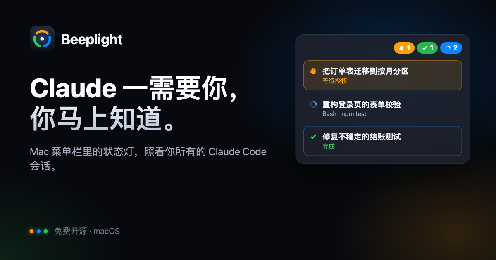

<p align="center">
  <a href="https://beeplight.dev/zh/"></a>
</p>

# Beeplight — for Claude Code

**Claude 一需要你，你马上知道。** Beeplight 是 Mac 菜单栏里的一盏状态灯，照看本机所有 Claude Code 会话和 agent，免费开源。

[官网 beeplight.dev](https://beeplight.dev/zh/) · [English](README.md) · **简体中文**

每秒检查 3 次，把会话分成 **Doing**（执行中）、**Waiting**（等你）和 **Done**（已完成），点卡片直达任务所在的窗口。提交任务后就可以去做别的事，Claude 需要你或者做完了，菜单栏会告诉你。有 Mac 应用和网页两种界面，数据相同。界面跟随系统语言显示英文或简体中文，任务标题也跟随 Mac 的语言。想让 Beeplight 单独用某种语言，在 app 的「设置 → 通用」里选（和「系统设置 → 通用 → 语言与地区 → 应用程序」是同一个设置）。

> [!NOTE]
> **早期预览版**：还没有签名的安装包和 Homebrew，目前需要从源码构建，大约一分钟。签名、公证过的安装包会随第一个正式版本发布在[官网](https://beeplight.dev/zh/)和 [Releases](https://github.com/derek920/beeplight/releases) 上。
>
> Beeplight 是独立项目，与 Anthropic 无关，也未经其认可。Claude 和 Claude Code 是 Anthropic 的商标。

## 功能

- **菜单栏状态**：Claude 在干活时显示蓝色转圈加数量，有任务等你时显示橙色举手加数量（等太久会变红），都处理完了显示一个空心勾。
- **点击跳转**：直达 iTerm2 / Terminal 里的那个标签页、Claude 桌面端的那个会话，或者 VS Code、Cursor、Trae 里对应项目的窗口。后台会话（`claude --bg`）和已关闭的会话会在新的终端标签页里打开。
- **新完成提醒**：刚完成的任务会一直标着，直到你看过，就像未读消息。
- **跟着进展走的标题**：用一句话概括会话**现在**在做什么，而不是你最开始输入的那句；每一轮结束还会判定成功还是失败。
- **用量与额度**：5 小时和本周额度、消耗速度，快用完前提醒你。点开额度卡片能看详情：按你选的粒度看用量随时间的变化、额度曲线和到重置的推算，以及按模型、token 类型、项目、会话的拆分。
- **系统通知**：任务需要你、完成或失败时弹出，点按钮直达任务。
- **状态轨迹与今日统计**：每个任务一条彩色时间轴，工作和等你各花了多久，以及今天的汇总。
- **刘海灵动岛**：从 MacBook 刘海里长出来；没有刘海的屏幕上是一个可以随意拖动的胶囊。也可以平时隐藏，有任务需要你或完成时再出现。
- **随你装扮**：8 套预设和主题、6 种菜单栏样式，空闲时的形象颜色跟着剩余额度变。主题、预设和形象都是 JSON 包（[格式说明](docs/packs.md)）。
- **手机访问**：可选的局域网页面，配对后把手机变成摆在 Mac 旁边的状态屏。
- **你的其他 Mac**：通过你自己部署的中转服务，其他 Mac 上的任务也显示在看板上，端到端加密。
- **子 agent 和后台会话**：子 agent 显示在所属会话下面，`claude --bg` 后台会话也能看到。
- **CPU 占用**：整台 Mac 有多忙，其中 Claude Code 和 Beeplight 自己各占多少。

## 系统要求

- macOS 14 Sonoma 及以上，Apple 芯片或 Intel 均可
- 已安装并登录的 [Claude Code](https://code.claude.com/docs)
- 从源码构建还需要 Node.js 20.11 及以上和 Xcode Command Line Tools（`xcode-select --install`）。构建出的 app 自带 Node。

## 安装

```sh
git clone https://github.com/derek920/beeplight.git
cd beeplight
npm run app:install   # 构建 Beeplight.app 并装到 ~/Applications
open ~/Applications/Beeplight.app
```

`npm run app` 只构建到 `desktop/build/Beeplight.app`（按本机芯片），不安装。`npm run app:dist` 构建 Apple 芯片和 Intel 通用版，并打包成 DMG 方便分享。第一次构建会从 nodejs.org 下载 app 自带的官方 Node.js（每种芯片约 50 MB，按官方校验和核对），缓存在 `desktop/build/node`。没有 npm 依赖要装。

第一次使用时，macOS 会请求几项权限：

- **通知**：用于等你、完成和失败的提醒。
- **自动化**（控制 iTerm2 或 Terminal）：第一次跳转到终端标签页时。
- **接受传入连接**（`node`）：只在打开手机访问时。

## 使用 Mac 应用

- **菜单栏**：Claude 在干活时显示蓝色转圈加数量，有任务等你时显示橙色举手加数量（等太久会变红），都处理完了显示一个空心勾。点开是任务面板，点任意一行跳到对应窗口。
- **看板窗口**：三列看板。打开时 app 出现在 Dock 和 ⌘-Tab 里，关掉后只留在菜单栏。
- **系统通知**：任务等你处理、完成或失败时弹出，通知上的「跳转」按钮直达窗口。在 ⚙ 菜单里可以分别关闭。
- **登录时启动**：在 ⚙ 菜单里打开。
- **CPU 占用**：面板和看板底部显示整台 Mac 的 CPU 占用，以及其中 Claude Code（各会话和它们运行的命令）和 Beeplight（app、监控服务和它发起的 Haiku 调用）各占多少，按最近 10 秒取平均。三个数都是占整台 Mac 的比例，可以直接比较；活动监视器和 `top` 按单核算，等于这个数乘以核数。网页看板底部也有同一行。

app 自带 Node 和监控服务，并负责守护它，数据在 `~/Library/Application Support/Beeplight`。如果 7333 端口已经有监控服务在跑（比如 `npm start`），app 会直接用它。

注意：菜单栏图标太多时，macOS 会把放不下的图标藏到刘海后面。看不到图标的话，按住 ⌘ 把它拖到靠右的位置。

## 外观中心

在 ⚙ 菜单里点「外观设置…」，或在 app 前台时按 ⌘,，打开外观中心。右侧是实时预览。

- **一键预设**：原生 macOS、赛博霓虹、黑客终端、全息 HUD、极简专注、莓果奶霜、玫瑰暮色、奶糖。每个预设会同时设置下面四项，设完后每一项还能单独改。
- **主题**：决定看板、菜单栏面板和灵动岛的配色、字体和质感。莓果奶霜是深蓝灰底配柔和的马卡龙色，圆体字；玫瑰暮色是低饱和的玫瑰与金，app 里用衬线字体；奶糖是浅色，卡片带一圈淡粉描边。
  - 霓虹：暗底、霓虹描边、发光。
  - 终端：荧光绿等宽字、`[执行中]` 括号标签、CRT 扫描线。
  - 全息：深蓝网格、角标框、描边胶囊。
  - 极简：低饱和、无发光。
- **菜单栏样式**：
  - 胶囊计数：每种状态一个带数字的胶囊。
  - 红绿灯：「等你 / 执行中 / 新完成」三盏灯。
  - 雷达环：按状态分段的圆环，有任务执行时会转一圈扫描线。
  - 能量条：一格代表一个任务，执行中的格子会闪烁。
  - 终端文字：显示成 `W1 D2 ✓1▌`。
  - 单点：只显示最紧急状态的颜色和数量。
- **灵动岛**：
  - 刘海：从 MacBook 刘海里长出来，鼠标悬停展开任务列表，点一行跳转。点岛本身可以固定展开（显示图钉），点别处就收起。没有刘海的屏幕上显示为胶囊，可以拖到任意位置。
  - 悬浮：可以拖到任意位置，位置会记住。
  - 任务完成或需要你处理时，会自动弹开几秒显示提示。悬停展开和自动弹出都可以关；也可以设成平时隐藏，有任务需要你或完成时再出现。
  - 刘海两侧的「翅膀」会盖住一小段菜单栏（每侧约 60pt），没有任务时会收回去。
- **形象**：机器人眼睛、数字机器人、数字狗、数字猫、终端猫、终端狗（字符画），或经典图标。没有任务在跑、等你或新完成时，菜单栏和灵动岛会显示它，颜色和精神跟着剩余额度变：额度充足时是绿色、东张西望，用过一半变琥珀色、动得慢些，快用完时变红、睁不开眼。机器人时不时转一圈天线，额度越足转得越快。处理完最后一个任务时会眯眼笑一下。手机状态屏显示同一个形象；简笔形象会替换能量环中间的数字，演出每种状态：Claude 干活时上下晃动（机器人一直转着天线），有任务等你时跳起来提醒，完成时笑。终端猫和终端狗在菜单栏显示一行颜文字（`=o.o=`、`U•ᴥ•U`）；在状态屏上它们不用能量环，而是以完整的字符画在一条地平线上走来走去：空闲时时不时溜达一圈（额度越少走得越少越慢），Claude 干活时来回踱步，有任务等你时停下来跳。形象都在 `public/characters.json` 里，可以是细线简笔画（SVG 路径）或字符画，往里加一段就能多一个形象。
- **动效**：完整、柔和（只保留慢速转圈）、关闭。

网页版右上角的下拉框可以切换同样的 8 套主题，只记在当前浏览器里，和 Mac 应用的设置互不影响。

## 手机访问（局域网）

1. 在 Mac 应用里打开 ⚙ →「手机访问…」，打开「允许手机通过局域网访问」。
2. 手机连同一个 Wi-Fi，用相机扫页面上的二维码。
3. 添加到主屏幕：Safari 点「分享 → 添加到主屏幕」，安卓 Chrome 点「菜单 → 添加到主屏幕」。之后从主屏幕打开，就是全屏、像 app 一样的界面。

手机上的用法：
- **状态屏（手机上默认）**：把手机当副屏立在 Mac 旁边用。
  - 顶部是大号时钟和一句话状态，比如「2 个任务等你处理」，下面是计数和两条额度条。背景光的颜色跟着状态变，有任务等你时会缓慢呼吸。
  - 列表只显示等你的、新完成的和运行中的任务，点一行展开详情和「在 Mac 上打开」，新完成的点一下就算已读。
  - 横屏时左边是状态、右边是列表。
  - 右下角「详细」可以切到完整看板，完整看板里的「◱ 简洁」可以切回来。
  - HTTP 页面没办法让屏幕保持常亮，当副屏用时，把 iPhone 的「设置 → 显示与亮度 → 自动锁定」改成「永不」，或者用「引导式访问」。
- **完整看板，竖屏**：上方是 4 个计数和额度，下面用标签页切换「需要你 / 进行中 / 已完成」。
- **横屏**：变成桌面看板，三列任务并排显示，适合把手机立在桌上。
- **点卡片**：未读的点一下就标为已读，已读的点一下展开查看最近一次请求。「在 Mac 上打开」会把 Mac 上对应的窗口切到前台。
- **全屏按钮**：安卓 Chrome 可以直接全屏；iPhone 的 Safari 不支持网页全屏，要用「添加到主屏幕」。

安全与限制：
- **只监听 Wi-Fi 和有线网卡**，不监听 VPN 地址。所有接口都要校验配对码（二维码里带着），连续输错会被锁定一分钟。开关和配对码只能在这台 Mac 上改，「重置配对码」会让所有旧链接立即失效。
- **连接是 HTTP，没有加密**。只建议在家里、手机热点这类可信网络里打开。
- **公司 Wi-Fi 可能连不上**：很多公司 Wi-Fi 禁止设备互访。解决办法是在手机上打开「个人热点」，再用 USB 线连到 Mac，或者在 Mac 的蓝牙菜单里连接 iPhone 的网络。「手机访问」页会多出一个「iPhone USB」或蓝牙地址，并默认选中它，扫码即可。只要网络服务顺序里 Wi-Fi 排在 iPhone USB 前面，Mac 上网就仍然走公司 Wi-Fi，不会用手机流量。
- **防火墙**：第一次打开时 macOS 防火墙会问是否允许 node 接收传入连接，需要点「允许」。
- **没有锁屏推送**：HTTP 页面不能发系统推送，页面开着时会震动并弹出横幅，锁屏后收不到。

## iPhone 应用（即将推出）

配套的 iPhone 应用在 App Store 单独销售，不在这个开源仓库里。它和网页共用「手机访问」的开关和配对码：

- **状态屏和任务列表**：和手机网页一样的状态环、一句话状态、额度条和形象，加上等你、运行中、已完成的完整列表，以及「在 Mac 上打开」。
- **小组件**：主屏幕（小号、中号）和锁屏。系统刷新小组件时（大约 15 分钟或更久一次）和打开 app 时，小组件会自己去读 Mac 的状态；不在 Mac 所在的网络时，显示最后一次的状态和时间。
- **实时活动**：在锁屏和灵动岛上显示运行中和等你处理的任务，计时会一直走。
- **配对**：在 app 里扫二维码；或者在 Mac 上点「复制链接」后粘贴；或者输入 Mac 的地址和 6 位配对码。

目前的限制：和手机网页一样只能在同一个网络里用。还没有推送更新（需要加入 Apple 开发者计划），所以实时活动只在 app 打开时跟着 Mac 变；切到后台后保留最后的状态，超过两分钟会注明是多久以前的。

## 网页版

```sh
npm start                 # 前台运行，打开 http://localhost:7333
npm run service:install   # 注册为 LaunchAgent：登录自启、崩溃自动重启（已经在用 Mac 应用就不需要）
npm run service:status    # 查看状态；service:restart / service:uninstall
```

零依赖，需要 Node ≥ 20.11 和已登录的 `claude` CLI。

## 新完成提醒（未读）

提交任务后就可以去做别的事。任务从 Doing 变成 Done（成功或失败）时，会被标成「新完成」，和微信的未读消息一样，一直保留到你看过为止：

- **在哪里显示**：菜单栏会多一个绿色「✓N」，有失败的任务时是红色「✕N」。面板和看板里，未读的任务排在最前面，标题前有蓝点，卡片带蓝色描边。看板打开时，Dock 图标上的数字等于「需要你处理的」加上「新完成的」。
- **怎样算看过**：点开这个任务（面板、看板、系统通知都算）；给这个会话发了新消息；或者切到它所在的 iTerm2 / Terminal 标签页，停留两次检测（约 3 秒）。最后一种要等你第一次用「跳转」并允许了 macOS 的自动化权限之后才会启用。另外也可以点「全部已读」，或者移除这张卡。
- **哪些不算新完成**：监控启动时就已经结束的会话不算；一轮以提问结尾的也不算，那种算「等你回复」，放在 Waiting 列。
- **看不到的情况**：Claude 桌面端的会话不知道你当前打开的是哪一个，所以只能靠在监控里点开、或者给它发新消息来清除。

## Token 用量与额度

看板顶部有三张卡：**5 小时额度**、**本周额度**、**本周用量最多的会话**。每张任务卡片上也有一行本会话的用量。

- **额度详情**：点 5 小时或本周额度卡片（右上角「详情 ›」），看额度都用在了哪里。Mac 应用里会打开一个单独的窗口，网页看板（包括手机）上是一个浮层。
  - 选窗口和每根柱子代表的时长：5 小时窗口可选 10 分钟 / 30 分钟 / 1 小时，本周可选 1 小时 / 6 小时 / 1 天。
  - **额度用量**：这个窗口里服务端返回的额度读数，虚线按当前速度推算到重置。
  - **本机用量**：每个时间段一根柱子。鼠标指向某根柱子（手机上点按），可以看这段时间的 token 数、费用、请求数，以及用得最多的会话。
  - 这个窗口的用量按模型、token 类型（输入、输出、缓存写入、缓存读取）、项目和会话拆分。点会话可以跳过去。

- **额度百分比**：来自服务端，和 Claude Code 里 `/usage` 显示的是同一个数。它包含 claude.ai 网页和其他设备的用量。监控每次调 Haiku 总结时都会顺带带回最新额度。没有总结调用时，有活动的情况下每 10 分钟发一次极小的探测请求，没有活动时每小时一次。设置 `BEEPLIGHT_LIMITS_PROBE_MINUTES=0` 可以关闭探测。
- **窗口对齐**：本机 token 用量按服务端的重置时间切窗口。5 小时窗口是「重置时间往前 5 小时」，周窗口是「重置时间往前 7 天」，所以和额度统计的是同一段时间。
- **本机用量**：扫描本机所有 transcript（含子 agent），按消息去重后统计输入、输出、缓存写、缓存读。Claude Code 的 token 大部分是缓存读，所以总数会很大。金额按 API 价格折算，只用来给不同模型和缓存类型加权，不是账单。
- **单个会话占多少额度**：按这个会话在本机用量中的 API 等价成本占比，乘以服务端利用率估算。它假设用量全部来自本机，所以在网页上或其他设备上用得多时会偏高。
- **消耗速度**：根据最近 1 小时（周窗口用 12 小时）利用率的增长，预测会不会在重置前用完。
- **提醒**：任一窗口用到 80% 时，菜单栏会多出一个额度胶囊；用到 80% / 95% 时各发一次系统通知。通知可以在 ⚙ 菜单里关闭。
- **统计不到的部分**：带 `--no-session-persistence` 的调用、claude.ai 网页聊天、其他设备的用量，都只体现在服务端的百分比里。

## 状态轨迹与统计

每个任务都会记录状态变迁（Doing → Waiting → Doing → Done …）：

- **时间轴**：卡片上是最近 30 分钟的彩色时间轴。蓝色是执行，橙色是等你，淡绿是已完成。
- **本轮用时**：例如「本轮 运行 12 分 · 等你 40 秒」。
- **今天的统计**：完成和失败的轮数、Claude 累计工作时长、累计等你时长和最长一次等待，显示在顶部。
- **紧急提示**：授权或输入类的等待超过 3 分钟，卡片和菜单栏图标会变成红色警示，并带呼吸光晕。

「等你」只统计真正卡住 Claude 的等待（授权、输入）。一轮以提问结尾、等你给下一步指示的情况，时间轴上画成浅橙色，不计入。

## 状态怎么判定

| 看板 | 含义 | 依据 |
|---|---|---|
| **Doing** | Claude 正在工作 | Claude Code 自己写的会话状态为 `busy`；或这一轮结束了，但 Claude 说过要等后台任务跑完 |
| **Waiting** | 需要你确认或回复 | 停在授权、输入、对话框界面上（`waiting`）；或这一轮以向你提问、请你确认收尾 |
| **Done ✓** | 这一轮做完了 | 本轮结束，结果判定为已交付 |
| **Done ✗** | 这一轮没成功 | API 报错、被你中断、执行到一半会话被关、或者结果判定为没完成 |

「结果判定」和卡片标题由 Haiku 根据最近的对话总结，走 Claude Code 的无界面模式（`claude -p --model haiku`），用你的 Claude Code 登录。用 Claude 订阅登录时计入套餐额度，不单独收费；用 Anthropic Console 账号或 API key 时按 API 价格计费，每次约 $0.001。标题描述会话**当前**在做的核心任务，不是会话开头的那句话。每一轮开始和结束各总结一次，长时间运行的轮次每 5 分钟刷新一次。

从没收到过请求的空会话、以及超过 12 小时没有动静的会话不显示（执行中和等待授权的除外）。

## 点击跳转

| 会话在哪里 | 点击后 |
|---|---|
| iTerm2 / Terminal | 按 TTY 切到对应的窗口和标签页 |
| Claude 桌面端 | `claude://code/continue?session=local_…` 打开对应会话 |
| VS Code / Cursor / Trae 等 | 切到该项目的窗口（定位不到具体终端面板） |
| 后台会话（`claude --bg`） | 新开终端标签页运行 `claude attach <id>` |
| 已关闭的会话 | 新开终端标签页运行 `claude --resume <id>` |

第一次跳转时 macOS 可能会弹窗询问是否允许控制 iTerm2 / Terminal，需要允许。tmux 里的会话暂不支持定位。

## 跨设备同步

每台 Mac 上的 Beeplight 可以通过你自己部署的中转服务，看到其他设备上的任务。每台 Mac 上传自己看板的摘要，同时订阅其他设备的。其他设备的任务会标上设备名，计入「等你」和角标，也会触发同样的通知，但只能看：跳转和标为已读要在任务所在的那台 Mac 上做。

- **端到端加密**：每台设备上传前用 AES-256-GCM 加密，密钥只在你的设备之间共享。中转服务只看得到设备编号、数据大小和更新时间，看不到标题和状态，而且每个请求都要带访问令牌。
- **同步什么**：标题、目标、状态、状态标签、当前步骤（比如等你回答的问题，或「Bash · npm test」）、项目名、运行在哪个 app 里，以及状态轨迹。**不同步**：文件路径、你的提问、对话内容和 token 用量。
- **在线状态**：设备每 30 秒报到一次，超过 90 秒没有消息就显示为离线，保留它最后的任务状态。

把中转服务（`relay/server.js`，零依赖）部署在所有设备都能访问到的地方，前面套 HTTPS：

```sh
BEEPLIGHT_RELAY_TOKEN=$(openssl rand -base64 24) HOST=0.0.0.0 npm run relay   # 监听 7350 端口
```

```
# Caddyfile：给中转服务加 HTTPS
relay.example.com {
  reverse_proxy 127.0.0.1:7350
}
```

然后在第一台 Mac 上打开 ⚙ → 设置 → 设备，填中转服务地址和访问令牌，点「创建」。在其他 Mac 上粘贴那一页的加入码，点「加入」。加入码里有设备组的密钥，只发给你自己的设备。中转服务的数据都在内存里，重启后设备重新连上时会再上传一次。

部署在哪里要考虑数据规定：内容虽然加密，但还是会离开你的网络。想先在一台 Mac 上试，可以把中转服务跑在 `127.0.0.1`，再用 `PORT=7444 BEEPLIGHT_DATA_DIR=/tmp/tl2 BEEPLIGHT_DEVICE_NAME=Test npm start` 起第二个 Beeplight。

## 隐私

Beeplight 完全在本机运行，没有账号、遥测、统计或更新检查。

- **读取什么**：`~/.claude` 下 Claude Code 自己的文件（`sessions/`、`projects/` 里的 transcript、`jobs/`），以及进程列表。只读，不装 hook，也不改 Claude Code 的设置。
- **什么会离开本机**：为了生成标题和结果判定，Beeplight 会把每个会话最近对话的摘录，通过你自己的 `claude` CLI 登录发给 Claude Haiku。它和你平时用 Claude Code 一样发到 Anthropic，也会计入你的用量。额度探测是同一登录下的极小请求。总结目前还不能关闭，开关在计划中。
- **存了什么**：标题、判定、状态轨迹和设置，在 `~/Library/Application Support/Beeplight`（`npm start` 时在 `./data`）。历史数据最长保留 30 天，可以在设置 → 高级里调短，或立即清理。
- **网络**：服务只监听 `127.0.0.1`，并校验每个请求的 `Host` 头。手机访问默认关闭，见上面的「手机访问」。

## 配置

在 Mac 应用里，**设置 → 高级**列出了服务的全部运行参数，每项都有简短说明和默认值。大多数改动一秒内生效，端口要重启才生效。

不用 app 时，把参数写进数据目录下的 `config.json`（`npm start` 时是 `./data`，app 是 `~/Library/Application Support/Beeplight`）。改了文件，几秒内就会自动生效。

```json
{
  "collector.retainHours": 24,
  "summarizer.model": "sonnet"
}
```

`curl -s localhost:7333/api/config` 会列出每个参数的当前值、默认值和来源。全部参数及其取值范围见 [`src/config/schema.js`](src/config/schema.js)。

环境变量优先于文件。变量名是 `BEEPLIGHT_` 加上键名的大写下划线形式，例如 `BEEPLIGHT_COLLECTOR_TICK_MS=500`。下面这些旧变量名仍然有效：

| 环境变量 | 对应参数 | 默认 |
|---|---|---|
| `PORT` | `server.port` | `7333` |
| `BEEPLIGHT_MODEL` | `summarizer.model` | `haiku` |
| `BEEPLIGHT_RETAIN_HOURS` | `collector.retainHours` | `12` |
| `BEEPLIGHT_LIMITS_PROBE_MINUTES` | `limits.probeMinutes`（`0` 关闭探测） | `10` |
| `CLAUDE_BIN` | `claude.bin` | 从 `PATH` 查找 |
| `BEEPLIGHT_DEVICE_NAME` | `relay.deviceName` | 电脑名称 |

下面这几个只能通过环境变量设置：

| 环境变量 | 默认 | 作用 |
|---|---|---|
| `BEEPLIGHT_DATA_DIR` | `./data` | 运行参数、总结缓存、轨迹和日志目录（app 用 `~/Library/Application Support/Beeplight`） |
| `CLAUDE_CONFIG_DIR` | `~/.claude` | Claude Code 的配置目录 |
| `BEEPLIGHT_LANG` | 系统语言 | 状态标签和任务标题的语言，`en` 或 `zh-Hans`（app 会设成自己的语言） |

## 常见问题

**Beeplight 免费吗？** 免费。Mac 应用、网页看板和中转服务都以 Apache 2.0 开源。计划上架 App Store 的 iPhone 配套应用会收费。

**会改动我的 Claude Code 配置吗？** 不会。它只读取 Claude Code 自己的会话文件和 transcript，不装 hook，也不改设置。退出后什么都不会留下。

**会消耗我的 Claude 用量吗？** 会用一点。标题和结果判定由 Claude Haiku 通过你自己的 `claude` 登录生成，频率和费用见[状态怎么判定](#状态怎么判定)。

**会拖慢我的 Mac 吗？** 面板上 Beeplight 自己的 CPU 占用和 Claude Code 的并排显示，可以随时看。它只读取文件里新写入的部分，也只重画有变化的地方。

**能跳转到哪些终端和编辑器？** 见[点击跳转](#点击跳转)。tmux 里的会话暂时定位不到。

**能看到我其他 Mac 上的会话吗？** 能，通过你自己部署的中转服务，见[跨设备同步](#跨设备同步)。

**Claude Code 升级会不会让它失效？** 有可能。Beeplight 读的是 Claude Code 的内部文件，格式可能会变；真变了，Beeplight 会跟着更新。

**Beeplight 是 Anthropic 做的吗？** 不是。它是独立项目，与 Anthropic 无关，也未经其认可。

更多问题见[官网](https://beeplight.dev/zh/#faq)。

## 已知限制

- 正在执行的工具（「Bash · npm test」这类进度）会晚 3～4 秒出现，因为 Claude Code 写 transcript 有缓冲。
- 状态来源 `~/.claude/sessions/*.json` 和 transcript 格式都是 Claude Code 的内部实现（基于 2.1.312 观察），升级后可能需要适配。

## 开发

```sh
npm start    # 监控服务，日志打到终端
npm test     # node --test
npm run app  # 构建 Mac 应用
```

监控服务零依赖，请保持这一点。[CLAUDE.md](CLAUDE.md) 介绍了架构和数据来源，[docs/packs.md](docs/packs.md) 是主题、预设和形象包的格式说明。

欢迎在 [GitHub issues](https://github.com/derek920/beeplight/issues) 提 bug 和想法。

## 许可证

[Apache License 2.0](LICENSE)。许可证不包括 Beeplight 的名字和图标：欢迎 fork，但请换一个自己的名字。

「莓果奶霜」和「奶糖」两个主题的配色来自 [Catppuccin](https://catppuccin.com)（Mocha 和 Latte），「玫瑰暮色」来自 [Rosé Pine](https://rosepinetheme.com)（Moon），两者都是 MIT 许可。
